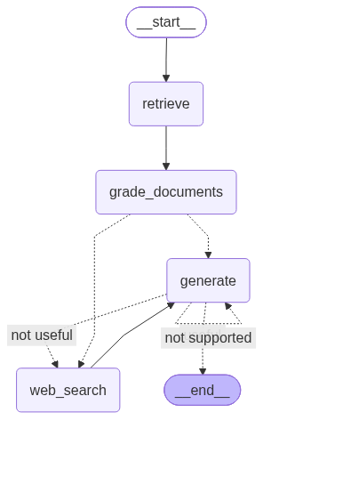

# Agentic RAG (Corrective Retrieval-Augmented Generation)

An  RAG system built with **LangGraph**, **LangChain**, **Google Gemini**, **ChromaDB**, and **Tavily Web Search**.

---

## 🎯 What Problem Does This Project Solve?

### The Failure Modes of Traditional (Naive) RAG
Standard Retrieval-Augmented Generation (RAG) follows a rigid, linear pipeline:
$$\text{User Query} \longrightarrow \text{Vector Search} \longrightarrow \text{LLM Prompt} \longrightarrow \text{Answer}$$

While effective for simple lookups, this static approach suffers from critical real-world limitations:

1. **Retrieval Blindspots & Irrelevant Chunks (Noise Injection)**:
   - Vector search relies purely on semantic similarity scores, often retrieving irrelevant or tangential passages.
   - Standard RAG blindly feeds these noisy chunks into the LLM context, diluting answer quality and causing hallucinations.
2. **Knowledge Gaps & Out-of-Domain Queries**:
   - If the local vector database does not contain information to answer the user's question, standard RAG either hallucinates or returns a generic "I don't know".
   - There is no dynamic mechanism to consult the live web or outside knowledge sources.
3. **Absence of Self-Correction**:
   - Traditional RAG cannot evaluate whether its retrieval succeeded. Once documents are fetched, there is no loop to verify relevance or take corrective action.

---

### How Agentic RAG Solves It

This project implements **Corrective Retrieval-Augmented Generation (CRAG)** orchestrated via **LangGraph**:



- **Active Document Grading**: Every retrieved chunk is inspected and scored using structured LLM evaluation (`yes` / `no`). Irrelevant chunks are pruned before generation.
- **Dynamic Web Search Fallback**: If retrieved knowledge is insufficient or missing, the agent automatically pivots to live internet search via the **Tavily API** to bridge knowledge gaps.
- **Noise-Free Context Synthesis**: The generator receives only validated, high-signal information, minimizing hallucinations and producing grounded, accurate responses.
- **Stateful, Observable Control Flow**: Built on LangGraph state machines, providing complete traceability, node-by-node debugging, and LangSmith telemetry.

---

## 🚀 Key Features

- **Self-Reflective Document Grader**: Uses Google Gemini (`gemini-2.5-flash`) with Pydantic structured output to deterministically grade chunk relevance.
- **Automated Fallback to Live Web**: Integrates Tavily Search to dynamically augment local document stores with real-time web intelligence.
- **Local Embedding Vector Store**: Local embeddings powered by `sentence-transformers/all-MiniLM-L6-v2` stored persistently in `ChromaDB`.
- **Cyclic Agentic Architecture**: Configured with LangGraph conditional edges (`decide_to_generate`) for resilient decision routing.
- **LangSmith Tracing Ready**: Full observability into LLM prompt chains, tokens, tool invocations, and latency.

---

## 🏗️ Project Architecture & Directory Structure

```text
agenticrag/
├── pyproject.toml              # Project dependencies and CLI entry point
├── requirements.txt            # Python requirements
├── .env.example                # Example environment variables template
├── graph.png                   # Compiled LangGraph workflow visualization
├── src/
│   ├── ingestion.py            # Document loading, chunking, embedding & vector store
│   ├── agenticrag/
│   │   ├── __init__.py
│   │   └── main.py             # CLI application entry point
│   └── graphs/
│       ├── const.py            # Node name constants
│       ├── state.py            # LangGraph GraphState definition
│       ├── graph.py            # LangGraph workflow definition & conditional routing
│       ├── nodes/
│       │   ├── retrieve.py         # Node: Retrieve documents from Chroma
│       │   ├── grade_documents.py  # Node: LLM document grading & routing flag
│       │   ├── websearch.py        # Node: Tavily web search fallback
│       │   └── generation.py       # Node: Final answer generation
│       └── chains/
│           ├── retriever_grader.py # Structured LLM relevance grader
│           ├── generation.py       # RAG answer synthesis chain
│           └── tests/
│               └── chain_test.py   # Pytest unit tests for grading & generation
```

---

## ⚙️ Prerequisites

- **Python**: `>= 3.11`
- **Package Manager**: [uv](https://github.com/astral-sh/uv) (recommended) or `pip`
- **API Keys**:
  - [Google AI Studio](https://aistudio.google.com/) for Gemini models (`GOOGLE_API_KEY`)
  - [Tavily AI](https://tavily.com/) for web search capability (`TAVILY_API_KEY`)
  - *(Optional)* [LangSmith](https://smith.langchain.com/) for tracing and evaluation

---

## 📦 Installation & Setup

### 1. Clone the Repository
```bash
git clone https://github.com/venkataviswas/agenticrag.git
cd agenticrag
```

### 2. Set Up a Virtual Environment

**Using `uv` (Recommended):**
```bash
uv venv
# On Windows:
.venv\Scripts\activate
# On Linux / macOS:
source .venv/bin/activate

uv sync
```

**Using standard `python` & `pip`:**
```bash
python -m venv .venv
# On Windows:
.venv\Scripts\activate
# On Linux / macOS:
source .venv/bin/activate

pip install -r requirements.txt
```

### 3. Configure Environment Variables
Copy `.env.example` to `.env` and fill in your API credentials:
```bash
cp .env.example .env
```

Edit `.env`:
```env
GOOGLE_API_KEY=your_google_gemini_api_key
TAVILY_API_KEY=your_tavily_search_api_key

# Optional LangSmith Tracing
LANGCHAIN_TRACING_V2=true
LANGCHAIN_API_KEY=your_langsmith_api_key
LANGCHAIN_PROJECT=agentic-rag
```

---

## ⚡ Quickstart

### Step 1: Ingest Knowledge Documents
Populate your local Chroma vector store with documents (by default, seminal research blogs on LLM Agents, Prompt Engineering, and Adversarial Attacks):

```bash
python src/ingestion.py
```
> This will download articles, split them into chunks, generate embeddings using `all-MiniLM-L6-v2`, and save the database to `./.chroma`.

### Step 2: Run the Agent
Run the main application:

```bash
python src/agenticrag/main.py
```
Or via the registered CLI script:
```bash
agenticrag
```

### Example Execution Walkthrough
When querying:
> *"What is agent memory?"*

1. **`retrieve`**: Searches ChromaDB for relevant passages on agent memory architectures.
2. **`grade_documents`**: Gemini inspects each chunk. If the chunks are relevant, it flags `web_search = False`.
3. **`decide_to_generate`**: Routes straight to generation if all documents are relevant. If any document is off-topic or insufficient, it dynamically activates `web_search`.
4. **`web_search`** *(if needed)*: Queries Tavily, adds fresh web context to the document pool.
5. **`generate`**: Generates a concise, factually grounded answer.

---

## 🧪 Running Tests

Unit tests are included to verify document grading accuracy and answer generation:

```bash
pytest src/graphs/chains/tests/chain_test.py -v
```

Tests cover:
- **`test_retrival_grader_answer_yes`**: Validates that matching questions yield a `yes` relevance score.
- **`test_retrival_grader_answer_no`**: Validates that out-of-domain questions (e.g. *"how to make pizza"*) yield a `no` relevance score.
- **`test_generation_chain`**: Validates context-based generation.

---

## 🔧 Customization

- **Add Custom Documents**: Modify `urls` in [src/ingestion.py](file:///c:/Users/tumba/Desktop/agenticrag/src/ingestion.py) to point to your own websites, or swap `WebBaseLoader` with `PyPDFLoader` or `DirectoryLoader` for local files.
- **Modify Chunk Size**: Adjust `chunk_size` and `chunk_overlap` in [src/ingestion.py](file:///c:/Users/tumba/Desktop/agenticrag/src/ingestion.py).
- **Change Models**: Update `model="gemini-2.5-flash"` in [retriever_grader.py](file:///c:/Users/tumba/Desktop/agenticrag/src/graphs/chains/retriever_grader.py) and [generation.py](file:///c:/Users/tumba/Desktop/agenticrag/src/graphs/chains/generation.py) to any supported Google Gemini model (e.g., `gemini-1.5-pro`).
- **Web Search Results**: Adjust `max_results` in [websearch.py](file:///c:/Users/tumba/Desktop/agenticrag/src/graphs/nodes/websearch.py).

---

## 🛠️ Technology Stack

| Component | Technology | Purpose |
| :--- | :--- | :--- |
| **Orchestration** | [LangGraph](https://github.com/langchain-ai/langgraph) | Cyclic graph control flow & state management |
| **Framework** | [LangChain](https://github.com/langchain-ai/langchain) | Prompt templates, document loaders, output parsers |
| **LLM & Grader** | [Google Gemini](https://ai.google.dev/) (`gemini-2.5-flash`) | Structured grading & grounded answer generation |
| **Vector Store** | [ChromaDB](https://www.trychroma.com/) | Persistent vector storage for document retrieval |
| **Embeddings** | [HuggingFace](https://huggingface.co/) (`all-MiniLM-L6-v2`) | Local, fast, cost-effective text embeddings |
| **Web Search** | [Tavily](https://tavily.com/) | Live internet fallback search for LLMs |
| **Package Manager**| [uv](https://github.com/astral-sh/uv) | High-speed Python package and project manager |

---

## 📄 License

This project is licensed under the MIT License. See [LICENSE](LICENSE) for details.
