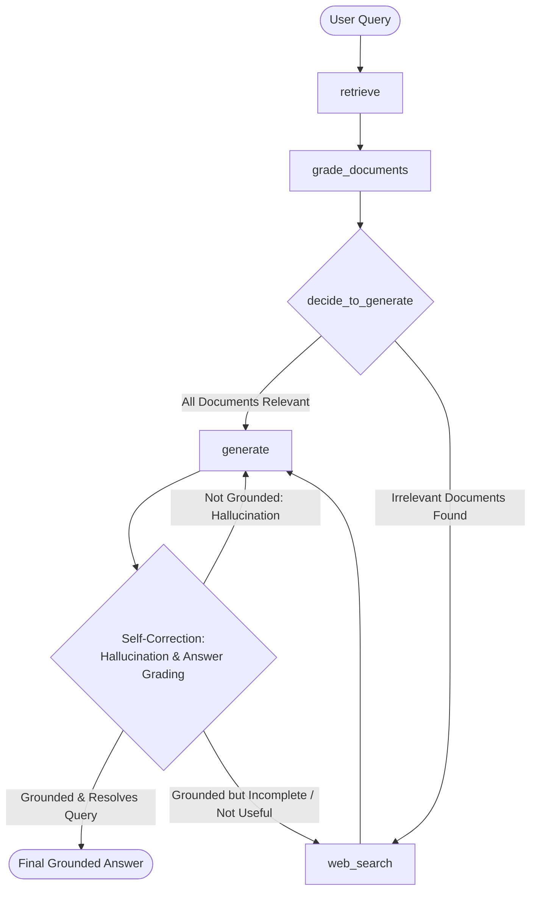

# Agentic RAG — Corrective (CRAG) & Self-Reflective (Self-RAG) with LangGraph

An advanced **Agentic RAG** system built with **LangGraph**, **LangChain**, **Google Gemini**, **ChromaDB**, and **Tavily Web Search**, featuring dual-stage pre-generation and post-generation self-correction loops.

---

## 🎯 What Problem Does This Project Solve?

### The Failure Modes of Traditional (Naive) RAG
Standard Retrieval-Augmented Generation (RAG) follows a rigid, linear pipeline:
$$\text{User Query} \longrightarrow \text{Vector Search} \longrightarrow \text{LLM Prompt} \longrightarrow \text{Answer}$$

While effective for simple lookups, this static approach suffers from critical real-world limitations:

1. **Retrieval Noise & Irrelevant Chunks (Noise Injection)**:
   - Vector search relies purely on semantic similarity scores, often retrieving irrelevant or tangential passages.
   - Standard RAG blindly feeds these noisy chunks into the LLM context, diluting answer quality and causing hallucinations.
2. **Knowledge Gaps & Out-of-Domain Queries**:
   - If the local vector database does not contain information to answer the user's question, standard RAG either hallucinates or returns a generic "I don't know".
   - There is no dynamic mechanism to consult the live web or outside knowledge sources.
3. **Absence of Self-Correction & Verification**:
   - Traditional RAG cannot evaluate whether its retrieval succeeded or whether its generated response is factually grounded in retrieved documents. Once documents are fetched, there is no loop to verify relevance or correct hallucinations.

---

### How Agentic RAG Solves It

This project integrates two state-of-the-art agentic RAG paradigms into a single LangGraph state machine:
- **Corrective RAG (CRAG)**: Evaluates retrieved document relevance and triggers live web search if information is missing or irrelevant.
- **Self-Reflective RAG (Self-RAG)**: Evaluates generated answers for hallucinations (groundedness in facts) and answer relevance (addressing user query), self-correcting via iterative regeneration loops.




---

## 🚀 Key Features

- **Document Relevance Grading (CRAG)**: Uses Google Gemini with structured Pydantic output (`GradeDocuments`) to evaluate every retrieved chunk against the query. Off-topic chunks are pruned before generation.
- **Dynamic Web Fallback (Tavily Search)**: When local documents are inadequate or irrelevant, the agent automatically falls back to real-time internet search via the **Tavily API** to augment context.
- **Self-Reflective Hallucination Detection (Self-RAG)**: Dedicated grader (`hallucination_grader.py`) checks whether the model's response is strictly grounded in the retrieved facts. If unsupported, it triggers automatic answer regeneration.
- **Answer Quality & Relevance Grading (Self-RAG)**: Second-stage grader (`answer_grader.py`) confirms whether the generation directly resolves the user query. If the local context proved insufficient to resolve the question, the workflow routes to Tavily search for additional information.
- **Cyclic Agentic State Machine**: Orchestrated via LangGraph with stateful conditional routing (`decide_to_generate` and `grade_generation_grounded_in_documents_and_question`).
- **Local Embedding Vector Store**: Persistent local vector search powered by Hugging Face `sentence-transformers/all-MiniLM-L6-v2` stored in `ChromaDB`.
- **LangSmith Tracing Ready**: Complete observability into LLM prompt chains, token counts, tool calls, and execution latencies.

---

## 🏗️ Project Architecture & Directory Structure

```text
Agentic-RAG/
├── pyproject.toml                  # Project dependencies and CLI entry point
├── requirements.txt                # Python dependencies
├── .env.example                    # Environment variable template
├── graph.png                       # Compiled LangGraph workflow visualization
├── src/
│   ├── ingestion.py                # Document loading, chunking, embedding & vector store
│   ├── agenticrag/
│   │   ├── __init__.py
│   │   └── main.py                 # CLI application entry point
│   └── graphs/
│       ├── const.py                # Node name constants
│       ├── state.py                # LangGraph GraphState definition
│       ├── graph.py                # LangGraph workflow definition & conditional routing
│       ├── nodes/
│       │   ├── retrieve.py         # Node: Retrieve documents from ChromaDB
│       │   ├── grade_documents.py  # Node: LLM document grading & web search flag
│       │   ├── websearch.py        # Node: Tavily web search fallback
│       │   └── generation.py       # Node: Final answer generation
│       └── chains/
│           ├── retriever_grader.py     # Document relevance grader (CRAG)
│           ├── hallucination_grader.py # Hallucination evaluator (Self-RAG)
│           ├── answer_grader.py        # Answer resolution evaluator (Self-RAG)
│           ├── generation.py           # RAG answer synthesis chain
│           └── tests/
│               └── chain_test.py       # Pytest unit tests for grading & generation
```

---

## ⚙️ Prerequisites

- **Python**: `>= 3.11`
- **Package Manager**: [uv](https://github.com/astral-sh/uv) (recommended) or `pip`
- **API Keys**:
  - [Google AI Studio](https://aistudio.google.com/) for Gemini models (`GOOGLE_API_KEY`)
  - [Tavily AI](https://tavily.com/) for web search capability (`TAVILY_API_KEY`)
  - *(Optional)* [LangSmith](https://smith.langchain.com/) for tracing and observability

---

## 📦 Installation & Setup

### 1. Clone the Repository
```bash
git clone https://github.com/VenkataViswas/Agentic-RAG.git
cd Agentic-RAG
```

### 2. Set Up a Virtual Environment

**Using `uv` (Recommended):**
```bash
uv venv
# On Windows:
.venv\Scripts\activate
# On Linux / macOS:
source .venv/bin/activate

uv sync
```

**Using standard `python` & `pip`:**
```bash
python -m venv .venv
# On Windows:
.venv\Scripts\activate
# On Linux / macOS:
source .venv/bin/activate

pip install -r requirements.txt
```

### 3. Configure Environment Variables
Copy `.env.example` to `.env` and fill in your API credentials:
```bash
cp .env.example .env
```

Edit `.env`:
```env
GOOGLE_API_KEY=your_google_gemini_api_key
TAVILY_API_KEY=your_tavily_search_api_key

# Optional LangSmith Tracing
LANGCHAIN_TRACING_V2=true
LANGCHAIN_API_KEY=your_langsmith_api_key
LANGCHAIN_PROJECT=agentic-rag
```

---

## ⚡ Quickstart

### Step 1: Ingest Knowledge Documents
Populate your local Chroma vector store with documents (by default, research articles on LLM Agents, Prompt Engineering, and Adversarial Attacks):

```bash
python src/ingestion.py
```
> This will download articles, split them into chunks, generate embeddings using `sentence-transformers/all-MiniLM-L6-v2`, and persist the vector database to `./.chroma`.

### Step 2: Run the Agent
Run the main application:

```bash
python src/agenticrag/main.py
```
Or via the registered CLI script:
```bash
agenticrag
```

---

## 🔄 Detailed Execution Walkthrough

When querying:
> *"What is agent memory?"*

1. **`retrieve`**: Searches local ChromaDB for candidate chunks relevant to the user's prompt.
2. **`grade_documents` (CRAG)**: Google Gemini inspects each retrieved chunk.
   - If relevant: the chunk is retained in the working context.
   - If any chunk is irrelevant or insufficient: the workflow sets `web_search = True`.
3. **`decide_to_generate`**:
   - If all chunks were relevant (`web_search = False`): proceeds directly to **`generate`**.
   - If any chunk was off-topic (`web_search = True`): pivots to **`web_search`**.
4. **`web_search`** *(if triggered)*: Queries Tavily Search, extracts web page content, wraps it as a Document, and appends it to the context pool before routing to **`generate`**.
5. **`generate`**: Synthesizes a grounded answer using the curated context.
6. **`grade_generation_grounded_in_documents_and_question` (Self-RAG Loops)**:
   - **Hallucination Check (`hallucination_grader`)**:
     - *Not Grounded (`not supported`)*: The generation contains unsupported claims. The workflow loops back to **`generate`** to re-synthesize.
     - *Grounded*: Proceeds to the answer relevance evaluation.
   - **Answer Check (`answer_grader`)**:
     - *Useful (`useful`)*: The response directly addresses and resolves the user's question. Execution concludes at **`END`**.
     - *Not Useful (`not useful`)*: The generation does not resolve the question. The agent triggers **`web_search`** to pull fresh external context and re-attempts generation.

---

## 🧪 Running Tests

Unit tests are included to verify document grading, hallucination detection, and answer generation:

```bash
pytest src/graphs/chains/tests/chain_test.py -v
```

Tests cover:
- **`test_retrival_grader_answer_yes`**: Confirms that relevant document passages yield a `yes` relevance score.
- **`test_retrival_grader_answer_no`**: Confirms that irrelevant queries (e.g. *"how to make pizza"*) against technical docs yield a `no` relevance score.
- **`test_generation_chain`**: Validates context-based answer generation.
- **`test_hallucination_grader_answer_yes`**: Validates that grounded answers pass hallucination evaluation (`binary_score == True`).
- **`test_hallucination_grader_answer_no`**: Validates that hallucinated / ungrounded answers are flagged (`binary_score == False`).

---

## 🔧 Customization

- **Add Custom Documents**: Modify `urls` in [src/ingestion.py](src/ingestion.py) to point to your target websites, or replace `WebBaseLoader` with `PyPDFLoader` or `DirectoryLoader` for local files.
- **Modify Chunk Size**: Adjust `chunk_size` and `chunk_overlap` in [src/ingestion.py](src/ingestion.py).
- **Configure LLM Model**: Update the model identifier in the chain definitions ([retriever_grader.py](src/graphs/chains/retriever_grader.py), [generation.py](src/graphs/chains/generation.py), [hallucination_grader.py](src/graphs/chains/hallucination_grader.py), and [answer_grader.py](src/graphs/chains/answer_grader.py)).
- **Web Search Results**: Adjust `max_results` in [websearch.py](src/graphs/nodes/websearch.py).

---

## 🛠️ Technology Stack

| Component | Technology | Purpose |
| :--- | :--- | :--- |
| **Orchestration** | [LangGraph](https://github.com/langchain-ai/langgraph) | Cyclic state graph control flow, routing, and self-correction loops |
| **Framework** | [LangChain](https://github.com/langchain-ai/langchain) | Prompt templates, document loaders, output parsers, and runnables |
| **LLM & Graders** | [Google Gemini](https://ai.google.dev/) | Document relevance grading, hallucination evaluation, answer grading, and generation |
| **Vector Store** | [ChromaDB](https://www.trychroma.com/) | Persistent vector database for embedding indexing and retrieval |
| **Embeddings** | [HuggingFace](https://huggingface.co/) (`all-MiniLM-L6-v2`) | Local, fast text embeddings |
| **Web Search** | [Tavily](https://tavily.com/) | Real-time search engine fallback for LLM agents |
| **Package Manager**| [uv](https://github.com/astral-sh/uv) | High-speed Python package and project manager |

---

## 📄 License

This project is licensed under the MIT License.
